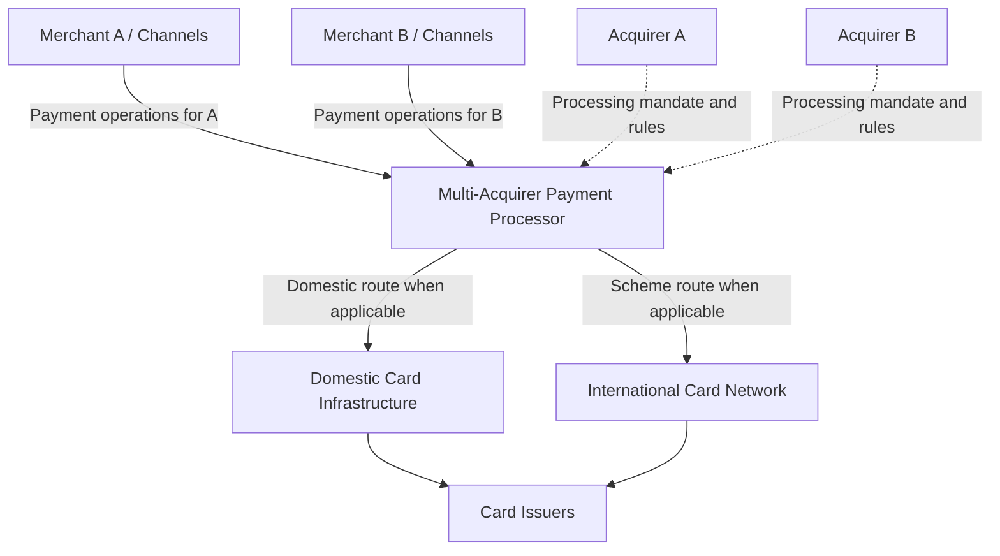
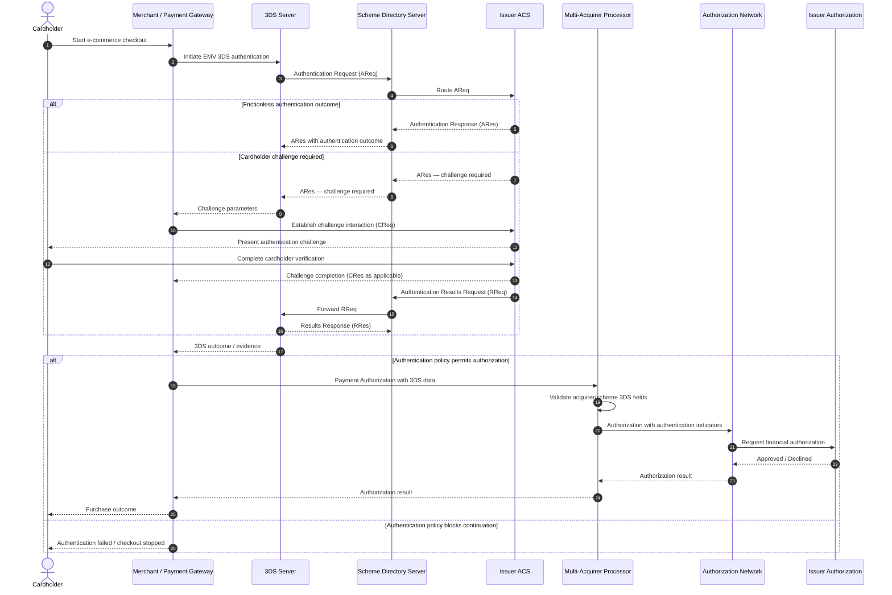
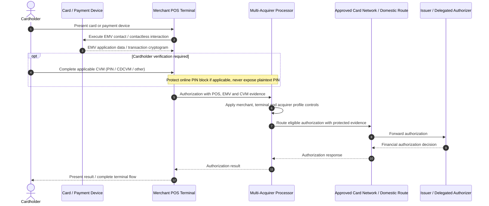
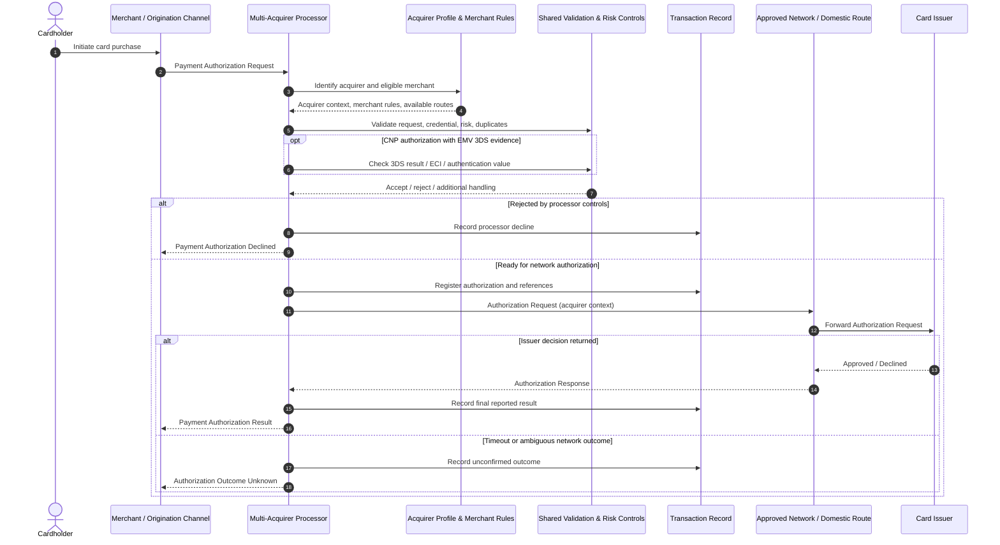
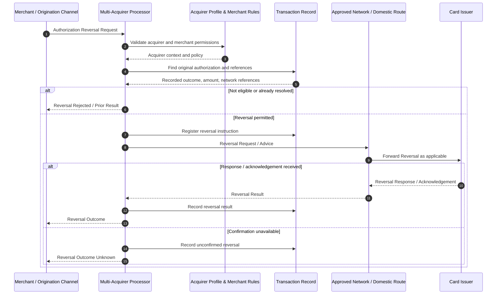
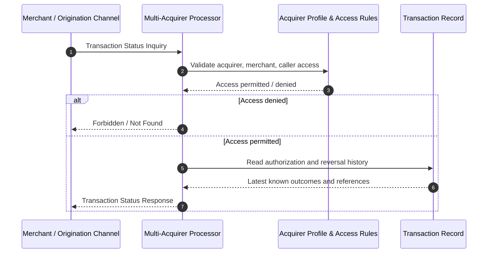
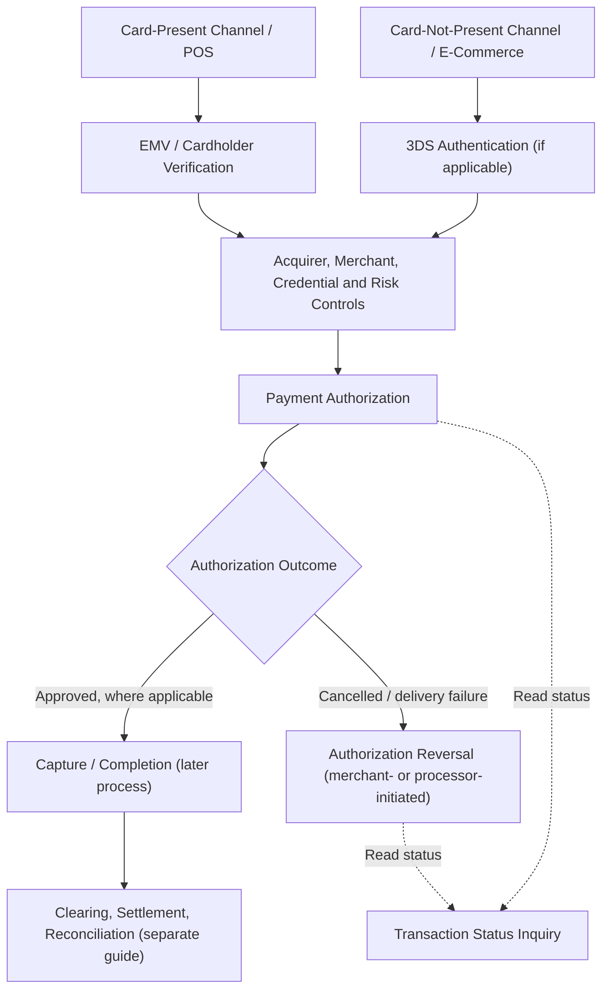

# Acquiring Simulator — Functional Process Guide

**Version:** 0.5.2  
**Date:** 2026-11-16  
**Status:** Working draft  
**Documentation and diagram language:** English  
**Conversation language:** Spanish  
**Business role:** Multi-Acquirer Payment Processor  
**Reference market:** Mexico (proposed baseline); LATAM-portable business model

> **Purpose:** A living, business-first guide for simulating card-payment authorization, authorization reversal, and transaction status inquiry on behalf of multiple acquirers. The actors, business responsibilities, message families, conditional EMV 3-D Secure (3DS), EMV card-present security, authorization variants, and exception cases are defined here without selecting a cloud platform, microservice topology, database technology, or a mandatory external messaging protocol.

## 1. Business model and role boundaries

Our organization is an **Acquirer Processor**, providing technical transaction-processing services to **multiple acquiring institutions**. We are **not** the merchant's contracting acquirer, the card issuer, a card scheme, or necessarily a payment gateway. A payment gateway, POS, or merchant API can be a transaction origin.

| Actor | Business role | Ownership / accountability |
| --- | --- | --- |
| Cardholder | Initiates a card payment | Holds an issuer-provided card or tokenized credential. |
| Merchant | Accepts the card | Has an acquiring relationship with an acquirer or authorized intermediary. |
| Origination Channel | POS, payment gateway, merchant API, or other approved channel | Submits an operation on the merchant's behalf. For e-commerce, it may act as the 3DS Requestor or consume an authentication service. |
| 3DS Requestor / 3DS Server (CNP only) | Merchant/PSP or contracted authentication service; the 3DS Server exchanges EMV 3DS messages | May be external to our processor, or supplied as an optional processor-managed service. Not every acquirer processor operates one. |
| 3DS Directory Server (DS) | Authentication-domain routing infrastructure associated with the card scheme | Routes EMV 3DS authentication messages toward the appropriate issuer ACS; separate from authorization-network messages. |
| Issuer Access Control Server (ACS) | Issuer-controlled or delegated cardholder authentication service | Determines frictionless/challenge outcome and authenticates the cardholder where applicable; separate from the issuer payment authorization decision. |
| Acquirer A / B / C | Acquiring institution or eligible nonbank acquirer | Holds merchant relationship and scheme/network obligations as applicable; appoints the processor. |
| **Our Acquirer Processor** | **Shared processing service for multiple acquirers** | Receives operations, validates, applies acquiring rules, records activity, and routes using the relevant acquirer's credentials and approved network connections. |
| Domestic Card Infrastructure | Local switch / clearing infrastructure, where applicable | Processes or routes domestic payment messages under local rules; not necessarily present in every transaction. |
| International Card Scheme / Network | Visa, Mastercard, etc. | Defines scheme rules and connectivity; participates in appropriate authorization routing. |
| Issuer | Institution that issued the card | Makes the issuer authorization decision; may place or release a hold or adjust credit availability. |

### Identifier precision

- **Issuing BIN / IIN:** a prefix of a card's PAN used to identify the issuer; six- and eight-digit issuing BINs can coexist. Do not assume that the acquirer owns the issuing BIN.
- **Acquirer Identifier:** a scheme-specific identifier for the acquiring institution, such as Visa's acquiring ID (separate from an issuer BIN). Mastercard and domestic infrastructure have their own membership and identification conventions.
- **Merchant ID (MID):** the identifier under which an acquiring relationship recognizes the merchant, with assignment and scope defined by the acquirer/processor arrangement.
- **Processor's internal Acquirer Reference:** our business identifier for the acquirer whose mandate is used for the operation. It is conceptually distinct from card/network identifiers.
- **Routing rule:** a transaction must be associated with the correct acquirer and merchant context; the issuer/card product and market/network requirements then determine which available route is valid. Shared processing never implies sharing an acquirer's credentials with another acquirer.

### Ecosystem relationship diagram

The commercial relationship is not necessarily an extra real-time network hop. The acquirer can be represented by its authorized routing profile and contract rather than a synchronous call to its bank for every authorization.

## 2. Reference-market decision: Mexico, LATAM-portable design

**Proposal:** Use **Mexico** as the first market profile because it is a major Latin American card market with observable debit/credit usage, bank and nonbank acquirers, payment aggregators, and both domestic card infrastructures and international networks. It offers a realistic test of multi-acquirer and domestic-versus-international routing concepts.

Banco de México's report for 2025 shows approximately **12,118.9 million card operations**, including **8,625.5 million debit-card operations** (approximately 71% by transaction count). The report identifies E-Global, Prosa, Mastercard, and Visa among authorized Mexican card-clearing infrastructures; it distinguishes issuers, acquirers, switches, schemes, aggregators, and specialist service providers.

**Important qualification:** Mexico is a useful reference, **not** a universal LATAM template. Brazil, Colombia, Peru, Chile, and Ecuador differ in local rails, clearing models, acquiring eligibility, scheme/network rules, authorization and settlement mechanisms, fee structures, and regulation. Model country-specific behavior as a market profile; do not embed Mexican rules into the universal business workflow. Test portability later against a second Latin American market.

**Initial functional scenario (proposal):** Mexican domestic **debit-card purchase**, initiated by a **simulated POS**, routed through an allowed market/network path. **An additional simulated e-commerce (CNP) channel is necessary to exercise EMV 3DS; 3DS is not generally part of the physical chip/contactless POS purchase flow.** “Online authorization” means a real-time request to the issuer, not necessarily e-commerce. Do not choose ISO 8583 single-message vs dual-message or debit posting semantics until a specific card-scheme and route profile is selected.

## 3. ISO 8583 and ISO 20022 are both relevant

It is inaccurate to say ISO 20022 cannot represent card authorization. **ISO 20022 includes a dedicated Cards domain**, not only bank-to-bank credit transfers. Its message families include:

| Business interaction | ISO 8583 (common interface families, profile-dependent) | ISO 20022 Cards domain |
| --- | --- | --- |
| Card authorization request / response | `0100 / 0110` are common authorization MTIs | `cain.001` AuthorisationInitiation; `cain.002` AuthorisationResponse (acquirer-to-issuer) |
| Authorization reversal | `0400 / 0410` or `0420 / 0430`, as supported by the particular interface | `cain.005` ReversalInitiation; `cain.006` ReversalResponse |
| Card acceptor / acquirer interaction | Channel/acquirer-specific profiles and APIs | `caaa` family, including acceptor authorization and cancellation messages |
| Transaction status inquiry | No generic interoperable cardholder-transaction status request should be inferred from network-management `0800 / 0810` | `cain.016 / cain.017` are **InquiryVerification** messages; do not assume that they universally provide our required authorization-status lookup |

**Working decision:** Keep the *business process* and its semantic terms **messaging-standard-neutral**. A future **network/interface profile** determines what is actually transported to the external party: ISO 8583, ISO 20022 Cards, or a scheme/network-specific variant or API. A modern input contract (REST, gRPC, etc.) is separate from the external network messaging contract. Do not promise direct ISO 20022 connectivity to a scheme or local switch without confirming its implemented interface specification and certification rules.

ISO 8583 remains highly relevant for real-world card authorization interfaces, while ISO 20022 gives us a documented card business-message model worth evaluating. **Message existence in an ISO catalogue does not prove live network support in our target market.**

## 4. Cardholder Authentication — EMV 3-D Secure (conditional CNP subprocess)

**Business objective:** In an eligible *card-not-present* (CNP) checkout, authenticate the cardholder or obtain the issuer's EMV 3DS authentication assessment **before submitting the financial authorization**. This is a **related authentication subprocess**, not a fourth financial-processing operation and not a replacement for the issuer authorization. A successful 3DS result does not guarantee an approved payment.

**Applicability and boundaries:** EMV 3DS is typically used for e-commerce and in-app payments, where the payment channel and the cardholder's device/browser can support the required data exchange. The baseline *card-present POS* flow does not require this process. Not every CNP payment uses 3DS: exemptions, transaction types (e.g. merchant-initiated subsequent recurring payments), scheme, issuer, acquirer, and local rules affect applicability. An absent, unavailable, failed, or attempted authentication is **not automatically** an issuer authorization decline; whether to proceed is a scheme-, region-, acquirer-, and merchant-policy decision.

**Process participants:**

- **Cardholder / Merchant Checkout:** starts the purchase and, if required, completes a challenge in a browser, SDK, or banking application.
- **3DS Requestor:** usually the merchant, payment gateway, or PSP that initiates cardholder authentication.
- **3DS Server:** exchanges the EMV 3DS authentication messages on behalf of the 3DS Requestor; may be outsourced or offered as an **optional** capability by our processor.
- **Directory Server (DS):** routes authentication messages within the relevant card scheme's 3DS domain.
- **Issuer Access Control Server (ACS):** issuer-side service that evaluates authentication risk and optionally challenges the cardholder.
- **Our Acquirer Processor:** when acting as the authorization processor, receives and checks the required 3DS result information, associates it with the represented acquirer, and passes supported authentication indicators in the authorization request. It is **not automatically** the 3DS Server or ACS.

**High-level business activities:**

1. At CNP checkout, the merchant or its payment partner determines the applicable 3DS path and starts cardholder authentication when appropriate.
2. The 3DS Server sends an authentication request (**AReq**) via the scheme's DS to the issuer's ACS.
3. The ACS may finish **frictionlessly** with an authentication response (**ARes**) or request a **challenge**. A challenge can include OTP, bank-app confirmation, and other supported forms; the final result is delivered through the EMV 3DS result flow (**RReq/RRes**) when applicable.
4. The requestor receives the authentication outcome and associated evidence, potentially including an **Electronic Commerce Indicator (ECI)**, **authentication value** (e.g., Visa CAVV or Mastercard AAV/UCAF as applicable), **DS Transaction ID**, and protocol version. Scheme-specific field requirements govern whether each is present and how it is carried.
5. If the transaction is allowed to continue, the merchant/channel submits the **payment authorization** with the relevant authentication indicators; our processor validates them against the relevant acquirer/scheme profile and forwards them on the appropriate authorization network path.
6. The issuer independently returns its **payment authorization decision**. Authentication and authorization outcomes are retained as separate but correlated business evidence.

### 4.1 CNP Authentication and Authorization — default 3DS provider outside our processor

**Alternative processor offering:** A future version may offer a processor-managed 3DS service, which changes **who operates the 3DS Server** but not the distinction between authentication and payment authorization. The default model does not assume our acquirer processor owns merchant checkout, the DS, or issuer ACS.

**Key outcomes to simulate:** frictionless success, challenge success, challenge failure/cancellation, unavailable/attempted authentication, timeout/uncertain outcome, missing or invalid 3DS evidence, and a valid 3DS authentication **followed by issuer authorization decline**. Scheme-specific liability-shift effects must not be assumed without the applicable scheme rules and transaction parameters.

**Privacy/security:** Keep only permitted authentication indicators and audit references; do not store OTPs, cardholder secrets, authentication challenge answers, or sensitive authentication data. Use synthetic credentials and test authentication values in the simulator.

### 4.2 Card-Present EMV & Cardholder Verification (conditional CP subprocess)

**Business objective:** For a card-present (CP) contact/contactless transaction, preserve and process the applicable EMV payment evidence. The terminal and payment card/device perform the EMV interaction; the acquirer processor handles the resulting transaction information and security requirements, and the issuer or its delegate performs the applicable authorization and cryptographic/cardholder checks. **This is the CP-side counterpart to the previously documented CNP/3DS branch, not 3DS for POS.**

- **Terminal/card interaction:** EMV application selection, terminal risk processing and cardholder verification method (CVM) selection as applicable, plus generation of a transaction-specific application cryptogram; handling varies by contact/contactless card and market profile.
- **Online PIN (if applicable):** the terminal protects the PIN in an encrypted PIN block; any authorized PIN block handling or translation across different cryptographic domains needs approved cryptographic controls. The processor must not see or store the clear-text PIN. Not every CP transaction uses online PIN.
- **Processor role:** validate merchant/terminal context, preserve relevant entry-mode, CVM, and EMV data; protect sensitive authentication data; map to the approved network profile and route on behalf of the correct acquirer.
- **Issuer/network role:** perform or delegate applicable cryptogram/PIN verification and financial authorization; the authorization response does not mean clearing or payout occurred.

**Boundary:** This diagram intentionally excludes offline terminal approval, deferred authorization, and device certification, which require separate profiles and validation. Do not simulate PIN keys, real PANs, CVVs, or genuine EMV cryptograms using live payment credentials.

## 5. In-scope operations

### Operation A — Payment Authorization

**Business objective:** Request an issuer's decision for a card payment, acting on behalf of the merchant's acquiring institution.

**High-level activities:**

1. The cardholder initiates a purchase at a merchant using an origination channel.
2. The processor receives the authorization request and identifies the merchant, represented acquirer, amount, currency, and payment credential reference.
3. Shared controls verify the caller and merchant eligibility; validate the request; assess relevant fraud and transaction risk; handle potential duplicate business requests; and protect card credentials. For CNP, check supplied EMV 3DS authentication indicators and enforce the applicable acquirer/scheme policy. For CP, handle applicable EMV, entry-mode and cardholder-verification evidence. Do not force EMV 3DS onto a physical POS purchase.
4. The processor determines an approved domestic or scheme route **under the identified acquirer's context**.
5. The transaction is forwarded to the external infrastructure/network and issuer; the issuer approves or declines.
6. The processor records the result and response references and returns the outcome to the origination channel.
7. A timeout or ambiguous reply is treated as an **unconfirmed outcome**, not automatically as an issuer decline.

**Business outcomes:** approved, declined, or not yet confirmed. A partial approval needs an explicit accepted amount and channel handling; stand-in approval needs evidence about the decision-making party. Both are documented as follow-up functional scenarios (Section 12).

### Operation B — Authorization Reversal

**Business objective:** Request cancellation of an earlier authorization, when permitted by the card/network profile. This is **not** a refund of a captured/settled purchase.

**High-level activities:**

1. The merchant/channel or processor policy initiates a reversal referring to the original authorization.
2. The processor verifies the acquiring context and the authority to reverse that original transaction.
3. The processor checks original transaction references and whether a reversal is allowable; it guards against repeated instructions.
4. An eligible reversal is sent through the supported route using the appropriate original references.
5. The processor records the network response or the unresolved/ambiguous outcome and reports it to the initiator.
6. Under the relevant scheme rules, a reversal may also be **automatically initiated by the processor**, such as when a successful issuer/network response cannot be delivered to the POS; this is distinct from a merchant-requested reversal.

**Important:** a network acknowledgement is not always proof that the issuer/cardholder hold has already been released. Reversals are scheme- and message-profile-dependent.

### Operation C — Transaction Status Inquiry

**Business objective:** Return the latest state **known by our processor** for an earlier authorization and/or reversal, without assuming that every network offers an external status-query operation.

**High-level activities:**

1. An authorized channel or operator requests the status using a known transaction reference.
2. The processor identifies the acquirer and verifies access to the merchant's transaction.
3. The processor retrieves the original operation and any related reversal activity.
4. The processor reports the latest known outcome, source of information, and whether confirmation remains pending.

**Meaning of “status”:** The processor's evidence-based recorded outcome. It is not automatically proof of a posted debit, a released issuer hold, or a merchant payout. Scheme-based external inquiry is a separate optional capability requiring a confirmed supported profile.

## 6. Shared functional controls, not yet software components

The following are **business capabilities** shared by one or more processes. No separate service, database, or deployment model is mandated by this guide.

| Shared capability | Authorization | Reversal | Inquiry | Why it matters |
| --- | :---: | :---: | :---: | --- |
| Acquirer context and authorized mandate | ✓ | ✓ | ✓ | Know on whose behalf the processor is acting. |
| Merchant identity, eligibility and permissions | ✓ | ✓ | ✓ | Enforce each acquirer's commercial and access rules. |
| Channel authentication and contract validation | ✓ | ✓ | ✓ | Control who can request each operation. |
| Payment data protection and credential handling | ✓ | Limited | Masked access | Protect PAN/tokens and avoid unsafe retention or exposure. |
| Fraud / transaction risk evaluation | ✓ | Contextual | Usually not | Assess payment risk, not to be confused with onboarding KYB/KYC. |
| EMV 3DS authentication evidence / CNP rule validation | Conditional (CNP) | Usually not | Optional read-only | Accept, validate and propagate scheme-specific 3DS fields; 3DS challenge itself belongs to the 3DS authentication domain. |
| Duplicate-request controls | ✓ | ✓ | Read semantics | Avoid inconsistent outcomes on repeated requests. |
| Transaction references and evidentiary history | ✓ | ✓ | ✓ | Correlate requests, original authorizations, reversals, and outcomes. |
| Country, scheme and acquirer routing policy | ✓ | ✓ | Optional | Choose supported paths, not a global one-size-fits-all route. |
| Timeout and uncertain-outcome treatment | ✓ | ✓ | Reports uncertainty | Avoid treating missing communication as a definitive issuer response. |
| Auditability and operational observability | ✓ | ✓ | ✓ | Explain what the processor did and which actor decided. |

**KYC/KYB vs risk:** Merchant due diligence, onboarding and AML controls are distinct from a per-transaction fraud or authorization-risk decision. **Tokenization:** different forms (network payment tokens, merchant/processor tokens) have different actors and requirements; it is not always required for a one-time card purchase. The simulator should prefer synthetic payment credentials and avoid real PANs and sensitive authentication data.

## 7. Business situations to clarify before technical modeling

| Operation | Example business situation | Essential functional question |
| --- | --- | --- |
| CNP / 3DS | Authentication succeeds frictionlessly or after challenge | Which results/evidence must be included in the later authorization? |
| CNP / 3DS | Challenge fails, is cancelled, or authentication is unavailable | Under which market/scheme/merchant rules may payment authorization still proceed? |
| CNP / 3DS | Authentication succeeds but financial authorization declines | How do we report distinct authentication and authorization outcomes? |
| Authorization | Issuer approves | What evidence do we return and retain? |
| Authorization | Issuer declines | Do we distinguish processor decline from issuer decline? |
| Authorization | Network times out after dispatch | How do we communicate uncertainty without asserting a false result? |
| Authorization | Merchant repeats the request | How do we distinguish an intentional new payment from a duplicate? |
| Reversal | Merchant cancels an earlier authorization | Is the original transaction still eligible? |
| Reversal | Reversal is repeated | Do we return the prior outcome or initiate an additional network instruction? |
| Reversal | Reversal acknowledgement is missing | How do we represent the uncertainty to the merchant? |
| Inquiry | Original authorization outcome unknown | What is the latest *known* result and its source? |
| Inquiry | Reversal initiated while authorization was approved | How do we show the original approval and subsequent reversal separately? |
| All | Same processor serves Acquirer A and Acquirer B | How do we ensure the correct merchant, mandate, route and access scope? |

These are **business process exceptions**. The expanded coverage audit in Section 11 identifies additional variants and deferred operations. They are not commitments to an event bus, workflow engine, retry system, or physical state-machine component.

## 8. Deferred processes

Separate later financial/lifecycle guides will cover **authorization completion/capture (where applicable)**, presentment, clearing, settlement, merchant payout, interchange and other fees, FX, banking/correspondent rails where used, and reconciliation. Capture/completion is a distinct merchant-facing business activity, not the same as reconciliation. Refunds, disputes/chargebacks, and their evidence exchanges are also downstream operations, rather than authorization reversals. They may use the same transaction references but **must not be collapsed into the authorization request-response flow**.

Cross-border and currency-conversion examples are also later profiles. Never assume FX conversion or a correspondent bank on the real-time authorization path of every card payment.

## 9. Decision register

| ID | Decision | Status |
| --- | --- | --- |
| D-001 | Our role is **Multi-Acquirer Payment Processor**, not the acquiring institution itself | **Accepted** |
| D-002 | Conversation in Spanish; all project documentation and diagrams in English | **Accepted** |
| D-003 | Separate business processes: Payment Authorization, Authorization Reversal, Transaction Status Inquiry | **Accepted** |
| D-004 | Financial reconciliation is a separate process | **Accepted** |
| D-005 | Mexico as initial representative LATAM reference, without hard-coding Mexican rules globally | **Proposed** |
| D-006 | Debit card as initial high-volume scenario; simulated POS as first channel | **Proposed** |
| D-007 | Remain ISO 8583 / ISO 20022 neutral at the business-process level | **Proposed** |
| D-008 | Choose specific network/scheme, permitted domestic routing, and single- or dual-message profile | **Open** |
| D-009 | Choose exact external interface protocol only after checking actual network requirements | **Open** |
| D-010 | Validate country portability against another LATAM market | **Future** |
| D-011 | No architecture, storage, cloud or implementation-pattern decision yet | **Accepted for current phase** |
| D-012 | Add EMV 3DS as a **conditional CNP cardholder-authentication subprocess** before authorization, separate from issuer financial authorization | **Accepted** |
| D-013 | Default to external 3DS Requestor / Server; evaluate a processor-managed 3DS offering later | **Proposed** |
| D-014 | Add simulated e-commerce channel to cover 3DS in addition to initial physical POS | **Proposed** |
| D-015 | Add CP EMV/cardholder-verification handling as the corresponding POS security subprocess | **Gap confirmed; proposed for next process iteration** |
| D-016 | Cover automatic reversals, partial reversals and uncertain delivery outcomes | **Gap confirmed; proposed for next process iteration** |
| D-017 | Model authorization variants, network stand-in decisions and account verification without making them mandatory for first happy-path scenario | **Gap confirmed; staged** |
| D-018 | Explicitly define capture/completion, refunds and disputes as distinct later business operations | **Boundary clarified** |

## 10. Recommended next business-first artifact

**Business Operation Matrix**, one concise entry for each of the three core operations **plus the conditional EMV 3DS (CNP) and EMV/CVM (CP) subprocesses**, covering:

- Business trigger and authorized initiators
- Inputs and prerequisites
- Which party decides what
- Main-path outcomes
- Exceptions, duplicate handling, and uncertainty
- Required evidence and references for future operations
- Business-level response semantics

A **Transaction Lifecycle State Machine** is only a possible **later formalization** of the already-agreed lifecycle rules; it does **not** mean a mandatory software component. Do not prioritize it before stakeholders agree on the three functional processes and their exceptions.

## 11. Business process coverage double-check (2026-11-14)

**Audit framing:** This section distinguishes missing subprocesses inside our three agreed operations from additional business operations and from capabilities that are prerequisites rather than separate real-time payment operations. The primary operations remain **Payment Authorization, Authorization Reversal, and Transaction Status Inquiry**. EMV 3DS (CNP) and EMV/CVM (CP) are conditional authentication/security subprocesses.

| Gap / process | Role of our acquirer processor | Classification | Proposed staging |
| --- | --- | --- | --- |
| Card-Present EMV & Cardholder Verification | Accept and correctly route EMV/entry-mode/CVM evidence; protect encrypted PIN block when applicable | Conditional authorization subprocess; missing CP security branch | **Core next iteration** |
| Automatic Authorization Reversal | Issue a reversal under applicable network rules when delivery or completion fails; retain original transaction references | Conditional reversal initiation, distinct from merchant cancellation | **Core next iteration** |
| Acquirer / Merchant / Terminal Configuration | Maintain active acquirer mandate, allowed merchant/terminal identifiers, MCC, entry capabilities and routing/permission profile; PF/submerchant identifiers when applicable | Prerequisite and shared business configuration | **Core next iteration** |
| Partial and Full Authorization Reversals | Distinguish entire hold cancellation from adjustment to an authorized amount | Reversal variants | **Core next iteration** |
| Original transaction correlation & issuer/network response provenance | Retain merchant, original approval, network references, reason/response codes and whether issuer or network stand-in decided | Shared processing obligation | **Core next iteration** |
| Authorization variants: estimated, preauthorization, incremental, partial approval | Support applicable specialized purchases and explicit partial-amount responses; not universally available in every market/profile | Authorization branches; not separate core operations | Next scenarios |
| Network Stand-In Processing (STIP) | Recognize a scheme/network decision on behalf of the issuer; do not treat every approval as issuer-issued | Authorization outcome provenance / scenario | Next scenarios |
| Account Verification / Zero-Amount Verification | Check a payment credential when no purchase amount is due, subject to scheme/program rules | **Additional business operation**, separate from purchase authorization | Next scenarios |
| Stored Credential and Recurring / CIT-MIT | Handle relevant consent/initiator/credential indicators and link subsequent merchant-initiated charges | Conditional authorization scenario | Later profile |
| Network Tokens and Wallet Cryptograms | Accept approved tokens/cryptograms and map them to the selected network interface; not synonymous with 3DS | Credential handling capability | Later profile |
| Capture / Completion | Record/submit confirmation of an approved purchase where dual-message workflows require it | **Additional business operation**, logically after authorization and before presentment | Separate lifecycle guide |
| Refund / Credit | Send a return of funds for an already completed purchase; do not confuse with authorization reversal | Additional post-payment operation | Separate lifecycle guide |
| Disputes / Chargebacks | Receive, investigate and respond with merchant/processor evidence on behalf of an acquirer | Additional post-payment process | Separate disputes guide |
| Network connectivity / operations | Establish and operate permitted routes, session availability and security arrangements; use profile-specific network-management messaging | Cross-cutting external integration capability, not cardholder purchase | Architecture/integration phase |
| PCI DSS / PCI PIN / Key Management | Define sensitive-data boundaries, approved PIN-handling responsibilities and controls; never retain prohibited authentication data | Mandatory real-world security/compliance constraints, simulated safely | Design guardrails now; technical realization later |
| Merchant / acquirer onboarding and KYB delegation | Acquirer generally owns commercial underwriting and KYB; processor configures authorized mandates and servicing data, possibly supports delegated steps | Business onboarding/service-management process | Separate operations guide |
| Currency conversion / FX / DCC | Handle pricing, currency and DCC choice under supported channel/scheme rules when enabled | Conditional payment capability | Later cross-border profile |

### 11.1 Functional process landscape (not software architecture)

**Interpretation:** 3DS is conditional and is not mandatory for all CNP transactions; EMV and CVM requirements depend on device, card and scheme. An issuer decline normally does not proceed to capture. An unknown delivery outcome must not be treated as an issuer decline. **Refunds and disputes intentionally remain outside the diagram** because they belong to a subsequent financial or post-payment process, not the three-operation authorization simulator.

### 11.2 Agreed core versus growth path

**Keep as the first focused simulator slice:** one CP online authorization with synthetic EMV metadata, result propagation, automatic or merchant-initiated reversal, and status inquiry — always with correct acquirer, merchant, and terminal context. A second CNP scenario uses an externally simulated EMV 3DS path. This is a proposed prioritization, not a change to the already accepted three core operations.

**Do not silently expand v1 into full acquiring:** Capture, refunds, clearing, settlement, payouts, disputes, pricing and cross-border FX matter for an end-to-end processor but require separately modeled business operations. Account verification and advanced authorization variants should be made explicit before selecting exact scheme message profiles.

## 12. References (public sources reviewed through 2026-11-14)

- ISO 20022, Cards and Related Retail Financial Services SEG: https://www.iso20022.org/cards-and-related-retail-financial-services-standards-evaluation-group
- ISO 20022, message catalogue (current `cain`, `caaa` families): https://www.iso20022.org/iso-20022-message-definitions
- Visa, Numerics Initiative (issuer BIN vs acquiring ID): https://www.visa.com.ph/partner-with-us/info-for-partners/numerics-initiative.html
- Visa, BIN expansion service provider considerations: https://www.visa.com/en-us/business/support/numerics-initiative
- Banco de México, 2025 Annual Report on Financial Market Infrastructures (2025 card processing statistics): https://www.banxico.org.mx/publicaciones-y-prensa/informe-anual-sobre-las-infraestructuras-de-los-me/%7BDF8FE964-F97C-1B2D-777B-B026EF74C9CF%7D.pdf
- Banco de México, Authorized card clearing institutions: https://www.banxico.org.mx/marco-normativo/autorizaciones-camaras-comp.html
- Mastercard, ISO 20022 and JSON (2024): https://www.mastercard.com/global/en/news-and-trends/Insights/2024/iso-20022-and-json-balancing-standardisation-and-flexibility-in-.html
- Mastercard Engage, Real-Time Clearing supports ISO 8583 and ISO 20022: https://engagepartners.mastercard.com/English/solutions/solution/Real-Time%20Clearing
- ISO 8583:2023 overview: https://www.iso.org/standard/79450.html

- EMVCo, EMV 3-D Secure — Challenge Flow / Technical Features: https://www.emvco.com/dynamic/emv-3-d-secure-whitepaper-v2/challenge-flow/technical-features/
- EMVCo, EMV 3-D Secure — Challenge Business Overview: https://www.emvco.com/dynamic/emv-3-d-secure-whitepaper-v2/challenge-flow/business-overview/
- Visa, 3-D Secure overview: https://corporate.visa.com/en/solutions/visa-protect/insights/3d-secure.html
- Visa, CAVV and EMV 3DS evidence in authorization: https://usa.visa.com/dam/VCOM/global/support-legal/documents/cavv-vbn-public.pdf

- Mastercard, Transaction Processing Rules (10 June 2025), authorizations, reversal, partial approvals, refund: https://www.mastercard.com/content/dam/public/mastercardcom/na/global-site/documents/transaction-processing-rules.pdf
- Visa, Authorization and Reversal Processing Requirements for Merchants (2024): https://usa.visa.com/content/dam/VCOM/regional/na/us/support-legal/documents/authorization-and-reversal-processing-best-practices-for-merchants.pdf
- EMVCo, EMV Contact Chip and transaction-specific cryptograms: https://www.emvco.com/emv-technologies/emv-contact-chip/
- Visa, Card on File Data Inquiry, CIT/MIT and credential flows: https://developer.visa.com/docs/card-on-file-data-inquiry
- Visa, Request and Response Codes and Stand-In Processing results: https://developer.visa.com/api-reference/request-response-codes
- PCI SSC, PCI DSS scope and standards: https://www.pcisecuritystandards.org/standards/pci-dss/
- PCI SSC, PIN Security standard: https://www.pcisecuritystandards.org/standards/pin-security/
- PCI SSC, sensitive authentication data storage limitation: https://www.pcisecuritystandards.org/faqs/1318/
- Mastercard, Payment Facilitator and Submerchant identification requirements: https://www.mastercard.com/content/dam/mccom/global/documents/mastercard-rules.pdf
- Visa, Dispute Resolution overview: https://www.visa.com/en-us/support/business/dispute-resolution

## 13. Network and issuer failure scenarios — implementation-oriented addendum (2026-11-18)

**Scope:** Extend the exceptions in Sections 5, 7, and 11; do not replace those sections or introduce a fourth core business operation. The Mastercard network and issuer are separate **simulated actors**. Their technical implementation may use separate AWS Lambda functions. This section describes observable behavior, not a final software topology.

| ID | Injected behavior / failure point | Processor-visible evidence | Expected business behavior |
| --- | --- | --- | --- |
| NET-01 | Mastercard rejects malformed or disallowed message before issuer dispatch | Explicit network rejection; no issuer decision | Report network/processor rejection with provenance; do not label issuer decline. |
| NET-02 | Mastercard unavailable before forwarding | Dispatch failed or network unavailable | Retain failure provenance; apply only profile-authorized retry/reversal rules. |
| NET-03 | Mastercard forwards to issuer but response is lost | Request dispatched; no definitive response | Record **UNKNOWN / unconfirmed**, not DECLINED; preserve correlation and evaluate recovery/reversal. |
| NET-04 | Mastercard responds after processor timeout | Late response tied to original reference | Correlate with original; reconcile outcome without creating a second purchase. |
| NET-05 | Mastercard returns malformed or mismatched response | Invalid correlation, response or protocol fields | Reject response as evidence of issuer outcome; retain uncertain status and diagnostics. |
| ISS-01 | Issuer explicitly approves | Authenticated, correlated approval | Record APPROVED with issuer provenance and references. |
| ISS-02 | Issuer explicitly declines (e.g. insufficient funds) | Authenticated, correlated decline | Record DECLINED with issuer provenance and reason. |
| ISS-03 | Issuer unavailable or does not respond | Network may return error, stand-in result or timeout | Preserve actual decision provenance; do not fabricate issuer approval/decline. |
| ISS-04 | Issuer approves, but response is dropped by Mastercard | Issuer simulator records approval; processor sees timeout | Processor records UNKNOWN; simulator evidence proves divergence; recovery/reversal scenario must be tested. |
| ISS-05 | Issuer response delayed beyond network/processor timeout | Late or missing response | Keep uncertainty until verified; handle late responses idempotently. |
| PROC-01 | Merchant retries same business operation after timeout | Same idempotency/business reference | Do not produce an unintended second authorization; return known outcome or uncertainty. |
| REV-01 | Reversal requested after unknown authorization | Original dispatch evidence; uncertain issuer decision | Apply configured network/profile eligibility; preserve separate reversal outcome and references. |
| REV-02 | Reversal acknowledgment lost or repeated | Reversal sent, no definitive acknowledgment | Keep reversal status uncertain; avoid uncontrolled duplicate instructions. |
| INQ-01 | Inquiry while issuer-approved but processor-unknown | Processor journal says UNKNOWN | Return **processor's latest known status** and provenance; do not claim issuer confirmation without verified evidence. |

### Scenario execution and evidence contract

Each scenario must declare: `scenario_id`, operation (authorization/reversal/inquiry), acquirer/merchant/terminal context, injected actor and failure point, deterministic seed or fixture, correlation references, expected processor-visible result, and expected simulator-internal result. Keep internal issuer truth separate from what the processor could know at the time.

**Priority test:** ISS-04 / NET-03 (issuer approves, network drops response). Validate the processor journal, status inquiry, duplicate submission, and automatic reversal behavior as **separate observations**. Reversal timing, eligibility, retries, and final issuer state remain **profile-dependent**, not presumed universal Mastercard rules.

### Architecture evolution rule

C1 is a context view; C2 and C3 are **living implementation views**, not frozen specifications. Keep editable Mermaid sources and corresponding PNG exports synchronized and versioned with each meaningful implementation change. In C2, name actual AWS managed services (for example API Gateway, Lambda, DynamoDB, CloudWatch); functional modules such as routing or reversal are responsibilities **inside** those services, not fictional AWS products. The Mastercard and issuer simulators remain logically separate so network-only failures can be injected. This AWS realization is a **provisional design choice**, not a change to the business-process boundary.

