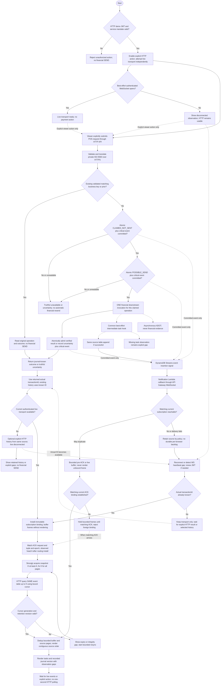

# Console observability activity flow

Status: conceptual source corrected for M1/M2; PROPOSED realization, not construction/deployment or rendering/QA evidence. Single demo JWT unchanged; exposure and retention remain separate unapproved choices.

[PNG: Console observability activity flow](activity-flow.png)

Editable diagram source: [`activity-flow.mmd`](activity-flow.mmd).

## Interpretation and invariants
- HTTP JWT/service authentication failure blocks unauthorized submission. WebSocket open/notification failure does NOT block an EXPLICIT HTTP action while HTTP auth and mandatory DynamoDB business/event persistence are healthy. OFFLINE/LIVE arrows are alternative observation paths, never automatic submit or duplicate payment triggers.
- SEND means at most ONE financial downstream invocation for the claimed operation. Both durable gates precede it. It has no retry/back-edge from event/task/notification/history/reconnect paths. Identical payment key replay reads original rather than entering a second SEND; crash after POSSIBLE_SEND remains conservative uncertainty, not resend permission.
- ACK contains routing-installed OBSERVED head A and immutable request/target/auth epoch/generation. A is not the query snapshot head. Strong snapshot acquisition selects H>=A (W01 A2/H3), FIXED for its pages. New frames beyond H are buffered/merged. Matching binding required before rendering any pre-ACK frame. Diagram MERGE is guarded by that ACK; raw delivery edge cannot bypass it.
- A new transactionId comes from the actual admitted HTTP operation, not subscription. If no ID is returned (e.g. unadmitted request), do not subscribe to a speculative ID. Existing history can enter via its known ID without another submission. Offline explicit history uses same source without an operational socket; live reconnection later enters SUB for install/ACK/catch-up.
- Source is ONE queryable functional event table; business state/critical event atomically written in DynamoDB. Streams signals notifications, not duplicate history materialization. SourceSequence commit order differs from arrival/occurrence order; duplicate callbacks/client pages have no payment effects.
- Subscription retries/conflicts/replacement/tombstones follow observation-contract.md O5a and channel-contract.md C8. Reauthentication/new epoch invalidates former ACKs/buffers. Subscribe/reconnect never causes financial SEND.
- Streams24h is not source retention. Retained source supports later catch-up; expired cursor/generation/retention revision returns resync/truncation, never silent complete history. Finite buffers and no per-browser durable backlog retained. Proposed seven-day payload policy does NOT delete financial journal/evidence/links.
- Intermediate task hooks obligatory but best-effort delivery; no missing task inferred FAILED. ADOT sampled/drop-prone, no financial proof. Single demo principal/JWT is separate from service IAM and business acquirer context; no multiuser management. Exposure, exact issuer/runtime/Java25 ADOT/IAM/cursor/key/cost/retention preflight remains pending.
- M1/M2/L1 source report domain-review.md MD5 1bfa8629a5321434515b51a4050f90d5; this is a correction submission, not reviewer closure. The .mmd source remains authoritative and the PNG is its rendered preview. Drive publication of this revision is the coordinator's step and remains pending; do not claim Drive currency from this local preview.
- Existing source references: [AWS Streams](https://docs.aws.amazon.com/amazondynamodb/latest/developerguide/Streams.html), [Lambda stream processing](https://docs.aws.amazon.com/lambda/latest/dg/with-ddb.html), [WebSocket callbacks](https://docs.aws.amazon.com/apigateway/latest/developerguide/apigateway-how-to-call-websocket-api-connections.html). Prior AWS/Context7 evidence, not fresh remote/runtime verification here.

## ISO security clarification
ISO8583 defines the message structure, not a universal transport or an unauthenticated trust model. IP allowlisting restricts network origin but does not provide cryptographic peer authentication. TLS/mTLS, private connectivity/VPN and message authentication codes are distinct profile/connection choices. D1 selected ISO payload over HTTPS; no raw TCP switch connection has been approved. Browser JWT identity and backend service identity are separate.

Verified references (2026-11-19): jPOS GenericSSLSocketFactory documents TLS client authentication and server certificate validation: https://jpos.org/doc/javadoc/org.jpos.jpos/org/jpos/iso/GenericSSLSocketFactory.html . Context7 /websites/jpos corroborates separate packager/channel configuration and MAC field support; not proof of required scheme security or deployed behavior.
