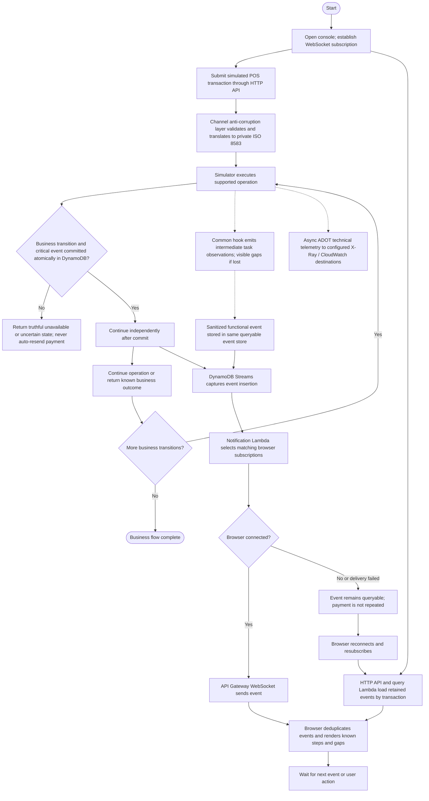

# Console observability activity flow

Status: candidate direction accepted for continued specification; detailed contracts and independent review pending. Not a deployed system or construction approval.

## Interpretation
- AWS business persistence is DynamoDB per Operation A AWS architecture update, not the earlier local SQL baseline. Business state and critical sanitized event are written atomically; consultable event rows are not copied into a second history table.
- Streams signals changes to a notification Lambda; API Gateway owns WebSocket connections. Backend connection/subscription records are technical routing state, not console user accounts. Lambda invocation/notifications can repeat; browser deduplication and retained-event catch-up are mandatory.
- Subscribe before catch-up and merge buffered live events by stable event identity; do not assume per-transaction total ordering from Streams across different items. Exact gap/cursor protocol is delegated for specification.
- Streams retention is 24 hours; the event store is the source for reconnect and longer replay. WebSocket delivery is not durable acknowledgement or proof of payment outcome. Notification outages do not gate payment. No automatic payment resend/reversal.
- Intermediate observations are distinct from atomic critical transitions; no full per-task durability is claimed. ADOT export is separate and can be sampled/dropped.
- No console login/users/roles. Current service JWT/IAM boundary needs explicit reconciliation, not silent removal. Seven-day functional retention and quantitative capacity/SLO limits remain proposed.
- References: [AWS Streams](https://docs.aws.amazon.com/amazondynamodb/latest/developerguide/Streams.html), [Lambda stream processing](https://docs.aws.amazon.com/lambda/latest/dg/with-ddb.html), [WebSocket callbacks](https://docs.aws.amazon.com/apigateway/latest/developerguide/apigateway-how-to-call-websocket-api-connections.html). Verified AWS/Context7 in the preceding conversation turn; no runtime validation implied.
