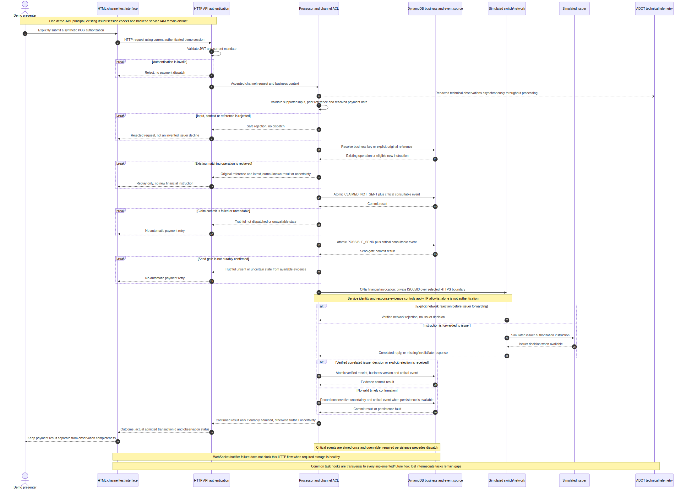

# Channel test interface — payment sequence

Status: documentation of selected functional direction, not construction, deployment, runtime or QA evidence. Exposure is approved presenter-operated screen-sharing with one demo JWT principal. Seven-day functional history is approved separately, numeric SLO/capacity and implementation/preflight remain unapproved.

This panel describes the current synthetic Operation A slice. The channel test interface is not a new financial operation. [Functional guide §§14–15](../../sources/acquiring_simulator_functional_guide.md#14-channel-test-interface-channel-interface-test) and [WI-ACQ-OBS-001](WORK_ITEM.md) define the business purpose and boundaries.

[PNG: Channel test interface — payment sequence](https://drive.google.com/file/d/1nb1gbNagGAvSsfCTi7_JEsmceb0GbsUP/view)

Editable diagram source: [`sequence-flow.mmd`](sequence-flow.mmd).

## Reading the sequence
- Each break is an early exit, not an additional invocation. Existing-key replay and ambiguous crash/restart never repeat financial dispatch.
- Both mandatory durable gates precede the single financial invocation. If evidence persistence later fails, a volatile reply/span/source observation cannot become a confirmed result.
- DynamoDB is the selected AWS business baseline, SQL harnesses are not an independent write target. Critical sanitized event and business change share the existing atomic contract, no duplicate projection/history payload.
- Switch and issuer are separate simulated actors, remote issuer truth is not proof of processor receipt. Future B/C capabilities and their wire/security profiles are not commissioned or invented here.
- Optional live/history notification sequence is a separate panel: [notification and recovery](sequence-recovery.md), [Mermaid source](sequence-recovery.mmd). This HTTP payment flow never depends on an available socket/notifier/ADOT backend, but does depend on mandatory business/event persistence.
- Transversal observability covers every implemented/future capability through the common hook/manifest. Intermediate/preauth tasks may be lost, technical spans may be sampled. Neither creates payment evidence.
- [Observation contract](observation-contract.md), [channel contract](channel-contract.md) and [private profile](iso8583-profile.md) retain detailed proposed realization, no new architecture rules or approvals added by this diagram.

## Source and status
Owner authority: owner-decisions.md MD5 144186943990aaa585283b9625a16b95, including separate screen-share and seven-day retention decisions. Activity diagram remains unchanged as historical local documentation, sequence is preferred for this presentation. PNG preview is presented from the exact editable source; Drive publication remains outside this local task. [Editable main source](sequence-flow.mmd).
