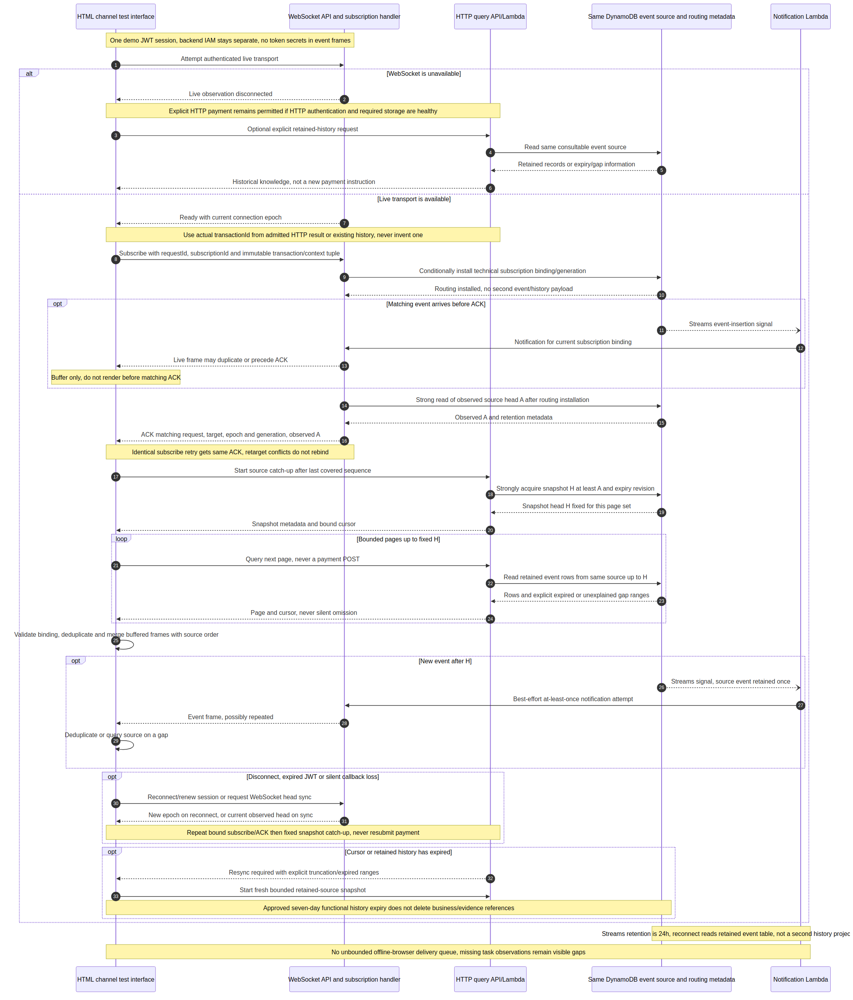

# Channel test interface — notification and recovery sequence

Companion to [payment sequence](sequence-flow.md). This panel has NO financial SEND or payment POST, API queries, subscription retries, reconnection and notification retries do not re-execute a payment. Selected functional direction and approved seven-day/screen-share decisions are not construction, exposure-to-public, runtime or architecture approval.

[PNG: Channel test interface — notification and recovery sequence](https://drive.google.com/file/d/1b2zB6jw9JpRg7QUt1I2BViQzVaRUib-a/view)

Editable diagram source: [`sequence-recovery.mmd`](sequence-recovery.mmd).

## Reading the sequence
- Source events are inserted once. Streams triggers notification, the query API reads the same event table for initial/history/reconnect catch-up. Technical routing metadata is not another history payload.
- Route installation precedes observed ACK head A. A new strong snapshot H may be greater than A and stays fixed for pagination. Before matching request/tuple/epoch/generation ACK, frames are buffered but not rendered. Dedupe/source order prevents repeated display effects, it cannot create financial truth.
- Retain M1 subscription retry/conflict/removal semantics in observation-contract.md O5a and channel-contract.md C8, this panel simplifies them without changing them.
- Missing callbacks recover through retained source and head sync, expiry is explicit truncation, not a promise that offline/unwritten tasks can always be recovered. There is no per-browser unbounded backlog. Streams24h and approved seven-day functional-history retention are different windows.
- A recorded event describes a journal version, not current authoritative outcome when journal cannot be read. No issuer truth is exposed through the demo.
- Common hooks remain obligatory for all implemented and future flows. Critical events are atomic, intermediate observations best effort, ADOT sampled separately. No new B/C operation, generic ISO inquiry or automatic reversal implied.

Source: current owner decisions and existing [observation](observation-contract.md)/[channel](channel-contract.md) contracts, no new research/runtime/crypto/QA claim. [Editable recovery source](sequence-recovery.mmd). Activity remains historical local, no Drive action performed.
