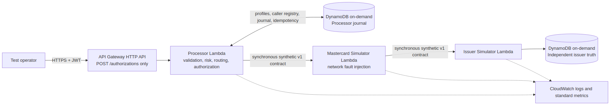

# Operation A: AWS implementation and local verification

This is a synthetic CP authorization slice, not an AWS deployment or a certified network integration. See `ai-sdlc/work-items/WI-ACQ-AUTH-001/aws-architecture-update.md` for owner evidence, scope, upstream sources, scenario mapping and remaining review gates.

## Build and test

```sh
export JAVA_HOME="$HOME/.local/opt/jdk-25"
"$HOME/.local/opt/maven/bin/mvn" test package
```

`target/lambda/` contains top-level compiled classes/resources and dependencies in `lib/`, suitable for the SAM template's CodeUri. The Spring Boot executable jar remains a separate local harness; do not upload its nested layout as the Lambda artifact. Unit tests mock Lambda transport; integration tests use disposable DynamoDB Local and PostgreSQL containers plus local SQLite. No AWS account is contacted by those tests.

## Infrastructure (not applied)

`infra/template.yaml` defines HTTP API JWT validation, three Java 25 ARM64 Lambdas, two on-demand DynamoDB tables, scoped IAM, API throttling and seven-day log retention. JWT issuer/audience have no permissive defaults. Processor can invoke only Mastercard and cannot read issuer truth; Mastercard can invoke only Issuer. The account's operators must restrict direct function invocation because event requestContext is trusted only at the API Gateway/IAM boundary. Independent Security review remains required.

A deployment requires separate human authorization and isolated account/region, JWT provider, verified Java 25 runtime availability, reviewed transformed CloudFormation and cost controls. No deploy/push/PR commands were executed. SAM/CloudFormation service deployment and real JWT delivery are not established by local tests.

## Registry provisioning

Generate a reviewable fixture document offline:

```sh
python3 scripts/render_aws_fixtures.py REVIEWED_JOURNAL_TABLE TEST_SUBJECT > fixtures.json
```

This reads the existing allowlisted synthetic fixture profile from application.properties and renders two DynamoDB items: `CONFIG#ACTIVE/PROFILE` and `CALLER#<subject>/PROFILE`. It does not write to AWS. The default caller is scoped to MERCH-SIM-001 in ACQ-SIM-001; review scope before any separately approved table write. Never use a JWT token as the subject argument. Seeding and JWT provider configuration are intentionally not performed by the application.

## HTTP request

`POST /authorizations` accepts the existing PurchaseRequest fields only. Use a valid JWT issued for the configured audience; its `sub` must have a registry mapping. Acquirer/caller identity and permissions do not come from headers or body supplied by the test client. Unknown JSON fields, including network fault overrides, are rejected. API responses contain only outcome/reference, not journal contents or issuer truth.

Example body:

```json
{"merchantRef":"MERCH-SIM-001","terminalRef":"TERM-SIM-001","channelPaymentReference":"ORDER-001","amount":10.00,"currency":"USD","credentialRef":"SIM-APP-001","entryMode":"SIMULATED_CONTACT","cvmIndicator":"SIMULATED_VERIFIED","cryptogramPresent":true,"riskIndicator":"PASS","priorReference":null}
```

HTTP 200 carries a business result, including processor rejection and uncertainty. Unknown/unregistered identity is 403, malformed payload 400, unsupported path 404, infrastructure failure 503. After 503 or timeout, retry the SAME business reference; never invent a new purchase reference to resolve uncertainty.

## Fault exercises

`NETWORK_FAULT` is a Mastercard Lambda operator setting: NONE, REJECT_BEFORE_ISSUER, UNAVAILABLE, DROP_RESPONSE, MALFORMED_RESPONSE, MISMATCHED_RESPONSE, LATE_RESPONSE. It cannot be selected by an HTTP caller. `DROP_RESPONSE` invokes and journals the issuer decision before suppressing delivery. `SIM-DEC-*` exercises issuer decline; `SIM-TMO-*` exercises issuer no response. Logical delays do not sleep or claim real AWS scheduling fidelity. Failure configurations are deterministic fixtures, not scheme rules.



[PNG: Operation A AWS implementation](architecture/operation-a-aws.png)

Editable diagram source: [`architecture/operation-a-aws.mmd`](architecture/operation-a-aws.mmd).

The editable scoped diagram is `architecture/operation-a-aws.mmd`, with matching `operation-a-aws.png` export; the imported upstream C1/C2 and PNG links remain proposals for the broader A/B/C system. Do not label them as the deployed topology.
